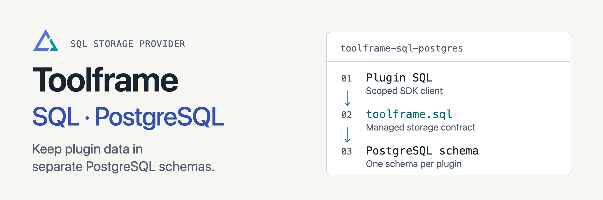

<p align="center">
<picture>
  <source media="(prefers-color-scheme: dark)" srcset="docs/assets/readme-banner-dark.png">
  <source media="(prefers-color-scheme: light)" srcset="docs/assets/readme-banner-light.png">
  
</picture>
</p>

# Toolframe PostgreSQL

[](https://github.com/toolframe/toolframe-sql-postgres/actions/workflows/ci.yml?query=branch%3Amain)

Store Toolframe plugin data in PostgreSQL, with a separate schema for each owner.
Use one database per application environment and provision access before enabling plugins.

## Quick start

Use Python 3.14+, PostgreSQL 16+ and `pg_dump` / `pg_restore` matching the server's
major version. Install the operator tools in a virtual environment:

```sh
uv venv --python 3.14
uv pip install --python .venv/bin/python   'toolframe-core>=0.8,<1' toolframe-sql-postgres==0.2.2
.venv/bin/toolframe-core --home ./app init
```

Continue with [provisioning](docs/setup.md): create the application database and
store owners, configure the SQL binding, then launch Core with the generated
private environment file. Setup needs administrator credentials; runtime workers
use the generated roles. Credentials belong in the process environment.

**Support:** one Core per application. Keep its application home, private keys
and artifacts persistent. Existing SQLite records are not imported, and adding
PostgreSQL does not make Core stateless or enable multiple replicas.

## Guides

| I want to… | Start here |
| --- | --- |
| Provision an application | [Setup](docs/setup.md) |
| Add stores, back up or restore | [Operations](docs/operations.md) |
| Understand isolation and SQL | [Storage contract](docs/storage-contract.md) |
| Review terminology and decisions | [Glossary](docs/glossary.md) · [Database boundary](docs/adr/0003-application-database-boundary.md) |
| Contribute or run checks | [Contributing](CONTRIBUTING.md) · [Verification](docs/development.md) |

[Releases](https://github.com/toolframe/toolframe-sql-postgres/releases)

## License

[Apache 2.0](LICENSE), with [NOTICE](NOTICE).
